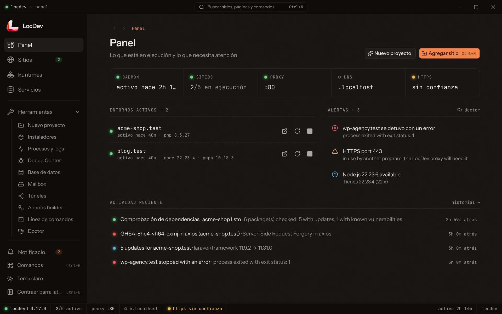

<p align="center"></p>

# LocDev

[English](README.md) · [Português (Brasil)](README.pt-BR.md) · [Español](README.es.md) · [日本語](README.ja.md)

Tus proyectos, runtimes y herramientas de desarrollo en un solo lugar. LocDev es un entorno de desarrollo gratuito y de código abierto para **Linux, macOS y Windows**, con aplicación de escritorio, CLI e interfaz de terminal sobre el mismo daemon en Rust. Ejecuta PHP, Node.js y otras stacks de forma nativa, sin exigir Docker ni WSL.

**[Documentación](https://locdev.app/es/docs) · [Descargar](https://locdev.app/es/download) · [Historial de cambios](CHANGELOG.es.md) · [Apoya el proyecto](https://locdev.app/es/donate)**



<a id="contents"></a>

## Índice

- [Instalación](#install)
- [Primeros pasos](#quick-start)
- [Qué incluye](#features)
- [Documentación completa](#documentation)
- [Referencia de la CLI](#cli)
- [Dominios y HTTPS](#network)
- [Arquitectura y desarrollo](#development)
- [Privacidad, seguridad y limitaciones](#security)
- [Contribuye y apoya](#community)
- [Desarrolladora y licencia](#credits)

<a id="install"></a>

## Instalación

Descarga el instalador de tu sistema en la [página de descargas](https://locdev.app/es/download) o en [GitHub Releases](https://github.com/trbros/locdev/releases/latest). La distribución de escritorio incluye `locdevd` y `locdev`. Los formatos dependen de la versión: `.dmg`, `.msi`/NSIS `.exe`, `.AppImage`, `.deb` y `.rpm`. Comprueba los archivos publicados para tu arquitectura.

Para instalar solo la CLI, el instalador verifica el archivo con el `SHA256SUMS` de la versión:

```sh
curl -fsSL https://github.com/trbros/locdev/releases/latest/download/install.sh | sh
```

```powershell
irm https://github.com/trbros/locdev/releases/latest/download/install.ps1 | iex
```

Estas direcciones requieren una versión publicada. La firma de código del sistema operativo y el actualizador firmado de la aplicación son mecanismos distintos; consulta las notas de la versión. Puedes usar runtimes ya instalados o instalar otras versiones desde LocDev.

<a id="quick-start"></a>

## Primeros pasos

Registra un proyecto existente e inicia su servidor de desarrollo. Sustituye la ruta del ejemplo por la carpeta de tu proyecto:

```sh
locdev start
locdev add /path/to/blog --name blog
locdev up blog
locdev domain blog
locdev logs blog -f
locdev doctor
```

Abre la URL que muestra `locdev domain blog`. La aplicación de escritorio ofrece las mismas operaciones; ejecuta `locdev` sin argumentos para abrir la interfaz de terminal. El framework se detecta y se sugiere un comando de desarrollo; también se admiten comandos personalizados. Detener o quitar un sitio del registro no elimina los archivos del proyecto.

<a id="features"></a>

## Qué incluye

| Área | Funciones |
| --- | --- |
| [Sitios y frameworks](https://locdev.app/es/docs/sites) | Detección de frameworks, registro de proyectos, carpetas supervisadas, pestañas de sitios, dominios, subdominios, comandos personalizados, logs y editor preferido. LocDev sirve directamente los sitios HTML estáticos. |
| [Runtimes y PHP](https://locdev.app/es/docs/runtimes) | Node.js y PHP por sitio; detección de versiones instaladas, valores predeterminados, versiones fijadas por proyecto y scripts de terminal. Integraciones con npm, pnpm, Yarn, Bun y Composer. Configuración de PHP con diff, copia de seguridad y validación; diagnóstico de extensiones obligatorias y recomendadas. |
| [Proyectos nuevos e instaladores](https://locdev.app/es/docs/new-project) | Instaladores oficiales cuando están disponibles, con vista previa del comando y terminal interactivo. Opciones de starter kit de Laravel, selección de runtime, base de datos opcional y registro del sitio. Archivos iniciales mínimos para stacks sin generador adecuado. |
| [Servicios y bases de datos](https://locdev.app/es/docs/services) | Instancias de PostgreSQL, MariaDB/MySQL, MongoDB, Redis y Valkey con datos, puertos, logs y copias en frío separados. Descargas verificadas cuando la fuente publica checksums; integración con gestores de paquetes del sistema para otras instalaciones. |
| [Database Manager](https://locdev.app/es/docs/database) | Tablas, filas, consultas y edición SQL, con confirmación de sentencias destructivas; explorador de claves Redis/Valkey. El daemon resuelve las credenciales. Se admiten instancias de MongoDB, pero no se incluye un explorador de datos MongoDB. |
| [Entorno y secretos](https://locdev.app/es/docs/environment) | Variables y perfiles compartidos, secretos cifrados e inyección solo en el proceso que conserva los valores del `.env` del proyecto. Sincronización revisada, copias de seguridad e historial al escribir archivos de entorno. |
| [Mailbox y Email Studio](https://locdev.app/es/docs/email-studio) | SMTP local solo de captura, bandejas por sitio, adjuntos e integración por framework. Bloques visuales de correo, Mailables, componentes y vistas previas estáticas o del framework, conservando Blade fuera de los bloques gestionados. |
| [Archivos de configuración](https://locdev.app/es/docs/config-files) | Formularios para opciones reconocidas, edición de código, análisis, diffs, copias de seguridad e historial. JSON y JS/TS se analizan sin ejecutar el código de configuración del proyecto; los valores calculados pueden ser de solo lectura. |
| [Git y GitHub](https://locdev.app/es/docs/git) | Cambios, commits, ramas, stashes, remotos y worktrees que pueden convertirse en sitios. Las operaciones destructivas incluyen vista previa, confirmación y copias de seguridad. Cuenta de GitHub, issues, pull requests y ejecuciones de workflows. |
| [GitHub Actions](https://locdev.app/es/docs/actions) | Plantillas por stack, edición visual y YAML, validación de seguridad, sugerencias de corrección, instalación opcional de actionlint e historial local de workflows. |
| [Dependencias](https://locdev.app/es/docs/dependencies) | Listado de dependencias, actualizaciones, compatibilidad y vulnerabilidades mediante OSV, con planes de actualización revisados antes de ejecutarlos. |
| [Deploy y uso compartido](https://locdev.app/es/docs/deploy) | Compatibilidad con plataformas, comprobaciones de preparación, generación de configuración y operaciones en las API de Vercel/Netlify conectadas. Comparte un sitio activo con Cloudflare Quick Tunnel, teniendo en cuenta el acceso público y los límites del proveedor. |
| [Debug Center](https://locdev.app/es/docs/debug-center) | Fallos de procesos, excepciones, logs de error, respuestas 5xx del proxy y dumps PHP, agrupados por problema con causas probables. Los secretos reconocibles se ocultan antes de almacenarlos; la retención es configurable. |
| [Métricas y Tinker](https://locdev.app/es/docs/metrics) | Conteo de peticiones del proxy, clases de estado, percentiles de latencia, rutas más visitadas y peticiones recientes, solo en memoria. Fragmentos y consola interactiva de Laravel Tinker con el PHP y entorno del sitio. |
| [Experiencia de escritorio](https://locdev.app/es/docs/app) | Inglés, portugués de Brasil, español y japonés; temas claro/oscuro, atajos configurables, paleta de comandos, bandeja, tareas en segundo plano, notificaciones, actualizaciones y comprobaciones de accesibilidad. |
| [Diagnóstico y automatización](https://locdev.app/es/docs/doctor) | Doctor comprueba runtimes, proxy, DNS, TLS e integraciones. Inicio de sesión opcional, modo sin conexión, cancelación y reintento de tareas y ajustes por automatización. |

<a id="documentation"></a>

## Documentación completa

El manual completo está en **[locdev.app/docs](https://locdev.app/docs)**. Los enlaces siguientes abren las guías en español de instalación, flujos de trabajo, configuración, mantenimiento y referencia. Los artículos fuente están en [`apps/docs/content/docs`](apps/docs/content/docs).

- [Qué es LocDev](https://locdev.app/es/docs/introduction)
- [Instalación](https://locdev.app/es/docs/installation)
- [Inicio rápido](https://locdev.app/es/docs/getting-started)
- [Recorrido por la aplicación](https://locdev.app/es/docs/app)
- [Atajos de teclado](https://locdev.app/es/docs/shortcuts)
- [Tutorial: un sitio Laravel desde cero](https://locdev.app/es/docs/tutorial-laravel)
- [Tutorial: un proyecto Node.js que ya tienes](https://locdev.app/es/docs/tutorial-node)
- [Tutorial: versiones de PHP y Node.js por proyecto y en la terminal](https://locdev.app/es/docs/tutorial-versions)
- [Sitios y procesos](https://locdev.app/es/docs/sites)
- [Carpetas monitoreadas](https://locdev.app/es/docs/parked-folders)
- [Dominios .test (DNS)](https://locdev.app/es/docs/domains)
- [Subdominios y comodines](https://locdev.app/es/docs/subdomains)
- [HTTPS y CA local](https://locdev.app/es/docs/https)
- [Runtimes y gestores de paquetes](https://locdev.app/es/docs/runtimes)
- [Configuración de PHP](https://locdev.app/es/docs/php-settings)
- [Frameworks y stacks](https://locdev.app/es/docs/frameworks)
- [Servidores de desarrollo](https://locdev.app/es/docs/servers)
- [Nuevo proyecto](https://locdev.app/es/docs/new-project)
- [Editor de código](https://locdev.app/es/docs/editors)
- [Debug Center](https://locdev.app/es/docs/debug-center)
- [Métricas de solicitudes](https://locdev.app/es/docs/metrics)
- [Tinker](https://locdev.app/es/docs/tinker)
- [Variables de entorno y secrets](https://locdev.app/es/docs/environment)
- [Servicios: bases de datos y cachés](https://locdev.app/es/docs/services)
- [Database Manager](https://locdev.app/es/docs/database)
- [Mailbox](https://locdev.app/es/docs/mailbox)
- [Email Studio](https://locdev.app/es/docs/email-studio)
- [Config Files](https://locdev.app/es/docs/config-files)
- [Asistente de deploy](https://locdev.app/es/docs/deploy)
- [Túneles](https://locdev.app/es/docs/tunnels)
- [Dependencias, jobs y notificaciones](https://locdev.app/es/docs/dependencies)
- [Git, GitHub y protección](https://locdev.app/es/docs/git)
- [GitHub Actions builder](https://locdev.app/es/docs/actions)
- [Solución de problemas](https://locdev.app/es/docs/doctor)
- [Solución de problemas](https://locdev.app/es/docs/troubleshooting)
- [Actualizar LocDev](https://locdev.app/es/docs/updating)
- [Desinstalar LocDev](https://locdev.app/es/docs/uninstalling)
- [CLI](https://locdev.app/es/docs/cli)
- [Configuración](https://locdev.app/es/docs/configuration)
- [Arquitectura](https://locdev.app/es/docs/architecture)
- [Seguridad](https://locdev.app/es/docs/security)
- [Iniciar con el sistema](https://locdev.app/es/docs/service)

<a id="cli"></a>

## Referencia de la CLI

Usa `locdev --help` y `locdev <comando> --help` para consultar los argumentos exactos. La [referencia completa de la CLI](https://locdev.app/es/docs/cli) se genera a partir de las definiciones de comandos.

| Área | CLI |
| --- | --- |
| Daemon y diagnóstico | `version`, `status`, `start`, `stop`, `restart`, `doctor` |
| Sitios y descubrimiento | `add`, `list`, `edit`, `up`, `down`, `reload`, `logs`, `remove`, `park`, `stack` |
| Red y certificados | `domain`, `subdomain`, `route`, `dns`, `tls`, `tunnel` |
| Runtimes | `runtime`, `tools` |
| Servicios y datos | `service`, `db`, `env`, `mail` |
| Herramientas de desarrollo | `new`, `config`, `email`, `debug`, `metrics`, `tinker`, `editor` |
| Código y automatización | `git`, `github`, `actions`, `deps`, `deploy`, `jobs`, `notifications`, `settings`, `startup`, `update` |

<a id="network"></a>

## Dominios y HTTPS

El proxy escucha en loopback y dirige los nombres de los sitios a los procesos de desarrollo, incluidos los WebSockets. `.localhost` funciona sin instalar una regla DNS. Para usar `.test`, revisa y aplica la configuración DNS. HTTPS usa una CA local cuya confianza es opcional y explícita.

Linux usa systemd-resolved cuando está disponible, macOS un resolver por dominio y Windows NRPT. Los cambios del sistema muestran un plan antes de solicitar privilegios. Las configuraciones de otras herramientas se notifican como conflictos, sin sustituirlas silenciosamente. El proxy usa HTTP 80 / HTTPS 443, con alternativas 7080 / 7443; Doctor explica los conflictos.

```sh
locdev dns status
locdev dns install
locdev tls status
locdev tls trust
```

<a id="development"></a>

## Arquitectura y desarrollo

El daemon concentra la lógica de negocio; la CLI y el escritorio envían solicitudes por IPC local. La lógica de dominio se divide en crates Rust. El escritorio usa Tauri, React y Tailwind; la documentación usa Next.js y next-intl.

Para desarrollar desde el código, instala Rust estable (edition 2024), Node.js 22.18+ para los tests TypeScript del sitio y el pnpm indicado en cada `package.json`. El escritorio también requiere los [prerrequisitos de Tauri](https://v2.tauri.app/start/prerequisites/).

```text
apps/locdev/       CLI + terminal UI
apps/desktop/      Tauri + React
apps/docs/         Next.js + next-intl
crates/            Rust: daemon, IPC, proxy, DNS, TLS, runtimes, tools
tools/definitions/ Framework definitions
```

```sh
git clone https://github.com/trbros/locdev.git
cd locdev
cargo build
cargo test
cd apps/desktop
pnpm install
pnpm tauri dev
```

`make check` ejecuta las comprobaciones del repositorio. Consulta el [`Makefile`](Makefile) para escritorio, documentación, capturas y accesibilidad. `pnpm dev` en `apps/desktop` usa un daemon simulado para trabajar en la interfaz; `pnpm tauri dev` abre la aplicación nativa. `LOCDEV_HOME` aísla estado, configuración e IPC; los puertos aún pueden entrar en conflicto con otro daemon.

Para configurar y desplegar el sitio, lee [`apps/docs/README.es.md`](apps/docs/README.es.md).

<a id="security"></a>

## Privacidad, seguridad y limitaciones

- Los archivos de proyectos y datos de la aplicación son locales por defecto. Las consultas a registros, descargas de runtimes, GitHub, comprobaciones de vulnerabilidades, proveedores de deploy y túneles hacen conexiones cuando se usan. Un túnel expone deliberadamente un sitio fuera del equipo.

- El daemon se ejecuta como tu usuario. DNS y confianza de la CA solicitan privilegios por separado. Los secretos usan el keyring del sistema o un almacén en archivo configurado explícitamente; no incluyas `.env` ni credenciales en Git.

- El acceso a bases de datos está pensado para desarrollo. Las conexiones remotas requieren consentimiento explícito; el soporte TLS de bases de datos es limitado. Lee la [guía de seguridad](https://locdev.app/es/docs/security) antes de conectar datos sensibles.

- Las métricas solo cuentan el tráfico del proxy y desaparecen al reiniciar el daemon. Detectar un framework no significa que todas sus versiones se hayan probado en todos los sistemas.

- La verificación de firma del actualizador no implica que cada instalador tenga firma de código del sistema. Comprueba los archivos de la versión, los problemas conocidos y los requisitos de la plataforma.

<a id="community"></a>

## Contribuye y apoya

LocDev crece con la comunidad. **Si te ahorra tiempo, ayuda a que siga creciendo:** dale una estrella al repositorio, compártelo con otros desarrolladores, comunica bugs reproducibles, mejora traducciones y documentación, prueba en tu sistema o envía una pull request concreta.

- [Cómo contribuir](https://locdev.app/es/contribute)
- [Bugs y solicitudes de funciones](https://github.com/trbros/locdev/issues)
- [Apoyo de la comunidad y al proyecto](https://locdev.app/es/donate)
- [Resolución de problemas y soporte](https://locdev.app/es/support)

La página de apoyo describe las formas disponibles de ayudar; no presupongas que existe un canal de pago. Para vulnerabilidades, usa el [canal privado de seguridad](https://locdev.app/es/security) en lugar de una issue pública.

<a id="credits"></a>

## Desarrolladora y licencia

<a href="https://triooo.com.br"><picture><source media="(prefers-color-scheme: dark)" srcset="apps/docs/public/brands/triooo/triooo_logo_dark.svg" /></picture></a>

Desarrollado y mantenido por **[triooo](https://triooo.com.br)**, junto con colaboradores de la comunidad.

LocDev se distribuye bajo la **[licencia Apache 2.0](LICENSE)**. Las dependencias conservan sus propias licencias. Los créditos de terceros están en la sección Acerca de la aplicación.
