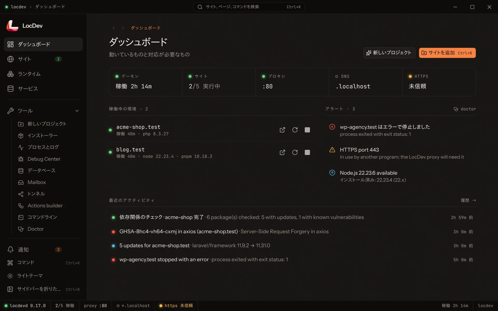

<p align="center"></p>

# LocDev

[English](README.md) · [Português (Brasil)](README.pt-BR.md) · [Español](README.es.md) · [日本語](README.ja.md)

プロジェクト、ランタイム、開発ツールを一か所に。LocDev は **Linux、macOS、Windows** 向けの無料のオープンソース開発環境です。デスクトップアプリ、CLI、ターミナル UI が同じ Rust デーモンを利用します。Docker や WSL を必須とせず、PHP、Node.js などのスタックをネイティブに実行できます。

**[ドキュメント](https://locdev.app/ja/docs) · [ダウンロード](https://locdev.app/ja/download) · [変更履歴](CHANGELOG.ja.md) · [プロジェクトを支援](https://locdev.app/ja/donate)**



<a id="contents"></a>

## 目次

- [インストール](#install)
- [クイックスタート](#quick-start)
- [主な機能](#features)
- [ドキュメント一覧](#documentation)
- [CLI リファレンス](#cli)
- [ドメインと HTTPS](#network)
- [構成とソースからの開発](#development)
- [プライバシー・セキュリティ・制限](#security)
- [貢献と支援](#community)
- [開発元とライセンス](#credits)

<a id="install"></a>

## インストール

[ダウンロードページ](https://locdev.app/ja/download)または [GitHub Releases](https://github.com/trbros/locdev/releases/latest) から、お使いの OS に対応するインストーラーを入手してください。デスクトップ版には `locdevd` と `locdev` が含まれます。リリースにより `.dmg`、`.msi`/NSIS `.exe`、`.AppImage`、`.deb`、`.rpm` が提供されます。実際に公開されているアーキテクチャとファイルを確認してください。

CLI のみをインストールする場合、インストーラーはリリースの `SHA256SUMS` でアーカイブを検証します。

```sh
curl -fsSL https://github.com/trbros/locdev/releases/latest/download/install.sh | sh
```

```powershell
irm https://github.com/trbros/locdev/releases/latest/download/install.ps1 | iex
```

これらの URL を使うには、公開済みのリリースが必要です。OS のコード署名とアプリ内アップデーターの署名は別の仕組みです。署名の状態はリリースノートを確認してください。既存のランタイムを利用するほか、LocDev から追加のバージョンをインストールできます。

<a id="quick-start"></a>

## クイックスタート

既存のプロジェクトを登録し、開発サーバーを起動します。パスは実際のプロジェクトフォルダーに置き換えてください。

```sh
locdev start
locdev add /path/to/blog --name blog
locdev up blog
locdev domain blog
locdev logs blog -f
locdev doctor
```

`locdev domain blog` が表示する URL を開きます。同じ操作はデスクトップアプリからも利用できます。引数なしで `locdev` を実行するとターミナル UI が開きます。フレームワークを検出して開発コマンドを提案しますが、独自のコマンドも指定できます。サイトの停止や登録解除でプロジェクトのファイルが削除されることはありません。

<a id="features"></a>

## 主な機能

| 分野 | 機能 |
| --- | --- |
| [サイトとフレームワーク](https://locdev.app/ja/docs/sites) | フレームワークの検出、プロジェクト登録、監視フォルダー、サイトのタブ、ドメイン、サブドメイン、独自コマンド、ログ、任意のコードエディターに対応。静的 HTML は LocDev 自身が配信します。 |
| [ランタイムと PHP](https://locdev.app/ja/docs/runtimes) | サイト別の Node.js と PHP、インストール済みバージョンの検出、既定値、プロジェクト別の固定バージョン、ターミナル用スクリプト。npm、pnpm、Yarn、Bun、Composer と連携。PHP 設定の差分、バックアップ、検証と、必須・推奨拡張の診断。 |
| [新規プロジェクトとインストーラー](https://locdev.app/ja/docs/new-project) | 利用可能な場合は公式インストーラーを使い、コマンドのプレビューと対話型ターミナルを提供。Laravel のスターターキット、ランタイム選択、任意のデータベース作成、サイト登録。適切な生成ツールがないスタックには最小限の初期ファイルを用意します。 |
| [サービスとデータベース](https://locdev.app/ja/docs/services) | PostgreSQL、MariaDB/MySQL、MongoDB、Redis、Valkey のインスタンスに、独立したデータ、ポート、ログ、コールドバックアップを用意。配布元がチェックサムを公開する場合は検証付きでダウンロードし、それ以外の導入では OS のパッケージマネージャーとも連携します。 |
| [Database Manager](https://locdev.app/ja/docs/database) | SQL のテーブル、行、クエリ、編集、破壊的な文の確認と、Redis/Valkey キーの閲覧。認証情報はデーモンが解決します。MongoDB インスタンスは利用できますが、MongoDB データブラウザーは含まれません。 |
| [環境変数とシークレット](https://locdev.app/ja/docs/environment) | 共有変数、プロファイル、暗号化されたシークレットを提供。プロジェクトの `.env` の値を維持し、プロセスにのみ注入します。環境ファイルへの書き込み時には同期の確認、バックアップ、履歴を利用できます。 |
| [Mailbox と Email Studio](https://locdev.app/ja/docs/email-studio) | 受信専用のローカル SMTP、サイト別の受信箱、添付ファイル、フレームワーク連携。メールブロック、Mailable、コンポーネントの視覚的な編集と、静的またはフレームワーク経由のプレビュー。管理対象ブロック以外の Blade は保持します。 |
| [設定ファイル](https://locdev.app/ja/docs/config-files) | 対応するオプションのフォーム、ソース編集、解析、差分、バックアップ、履歴。JSON と JS/TS はプロジェクトの設定コードを実行せずに解析し、計算された値は読み取り専用になる場合があります。 |
| [Git と GitHub](https://locdev.app/ja/docs/git) | 変更、コミット、ブランチ、stash、リモート、サイトとして登録できる worktree。破壊的操作にはプレビュー、確認、バックアップを用意。GitHub アカウント、issue、pull request、ワークフロー実行と連携します。 |
| [GitHub Actions](https://locdev.app/ja/docs/actions) | スタック別テンプレート、視覚的編集と YAML 編集、セキュリティ検証、修正提案、任意の actionlint 導入、ワークフローのローカル履歴。 |
| [依存関係](https://locdev.app/ja/docs/dependencies) | 依存関係の一覧、更新候補、互換性、OSV による脆弱性の確認。更新は実行前に計画を確認できます。 |
| [デプロイと共有](https://locdev.app/ja/docs/deploy) | プラットフォームとの適合性、準備状態、設定生成、接続した Vercel/Netlify API の操作。Cloudflare Quick Tunnel で実行中のサイトを共有できます。公開アクセスとプロバイダーの制限を確認してから利用してください。 |
| [Debug Center](https://locdev.app/ja/docs/debug-center) | プロセスの失敗、例外、エラーログ、プロキシの 5xx 応答、PHP ダンプを問題別にまとめ、考えられる原因を表示。認識できるシークレットは保存前に伏せ字にし、保存期間を設定できます。 |
| [メトリクスと Tinker](https://locdev.app/ja/docs/metrics) | プロキシのリクエスト数、ステータス分類、レイテンシーのパーセンタイル、上位パス、直近のリクエストをメモリーに保持。Laravel Tinker のコード実行と対話コンソールはサイトの PHP と環境を使います。 |
| [デスクトップ体験](https://locdev.app/ja/docs/app) | 英語、ブラジルポルトガル語、スペイン語、日本語に対応。ライト・ダークテーマ、変更可能なショートカット、コマンドパレット、トレイ、バックグラウンドジョブ、通知、更新、アクセシビリティ検証。 |
| [診断と自動化](https://locdev.app/ja/docs/doctor) | Doctor がランタイム、プロキシ、DNS、TLS、連携の問題を確認します。任意のログイン時起動、オフラインモード、ジョブのキャンセルと再試行、自動化ごとの設定を利用できます。 |

<a id="documentation"></a>

## ドキュメント一覧

完全なマニュアルは **[locdev.app/docs](https://locdev.app/docs)** にあります。以下は日本語のインストール、操作、設定、保守、リファレンスへのリンクです。記事のソースは [`apps/docs/content/docs`](apps/docs/content/docs) にあります。

- [LocDev とは](https://locdev.app/ja/docs/introduction)
- [インストール](https://locdev.app/ja/docs/installation)
- [クイックスタート](https://locdev.app/ja/docs/getting-started)
- [アプリの紹介](https://locdev.app/ja/docs/app)
- [キーボードショートカット](https://locdev.app/ja/docs/shortcuts)
- [チュートリアル: Laravel サイトをゼロから](https://locdev.app/ja/docs/tutorial-laravel)
- [チュートリアル: 既存の Node.js プロジェクト](https://locdev.app/ja/docs/tutorial-node)
- [チュートリアル: プロジェクトごと、ターミナルでの PHP と Node.js のバージョン](https://locdev.app/ja/docs/tutorial-versions)
- [サイトとプロセス](https://locdev.app/ja/docs/sites)
- [監視フォルダー](https://locdev.app/ja/docs/parked-folders)
- [.test ドメイン (DNS)](https://locdev.app/ja/docs/domains)
- [サブドメインとワイルドカード](https://locdev.app/ja/docs/subdomains)
- [HTTPS とローカル CA](https://locdev.app/ja/docs/https)
- [ランタイムとパッケージマネージャー](https://locdev.app/ja/docs/runtimes)
- [PHP の設定](https://locdev.app/ja/docs/php-settings)
- [フレームワークとスタック](https://locdev.app/ja/docs/frameworks)
- [開発サーバー](https://locdev.app/ja/docs/servers)
- [新しいプロジェクト](https://locdev.app/ja/docs/new-project)
- [コードエディター](https://locdev.app/ja/docs/editors)
- [Debug Center](https://locdev.app/ja/docs/debug-center)
- [リクエストメトリクス](https://locdev.app/ja/docs/metrics)
- [Tinker](https://locdev.app/ja/docs/tinker)
- [環境変数とシークレット](https://locdev.app/ja/docs/environment)
- [サービス: データベースとキャッシュ](https://locdev.app/ja/docs/services)
- [Database Manager](https://locdev.app/ja/docs/database)
- [Mailbox](https://locdev.app/ja/docs/mailbox)
- [Email Studio](https://locdev.app/ja/docs/email-studio)
- [Config Files](https://locdev.app/ja/docs/config-files)
- [デプロイアシスタント](https://locdev.app/ja/docs/deploy)
- [トンネル](https://locdev.app/ja/docs/tunnels)
- [依存関係、ジョブ、通知](https://locdev.app/ja/docs/dependencies)
- [Git、GitHub、保護](https://locdev.app/ja/docs/git)
- [GitHub Actions ビルダー](https://locdev.app/ja/docs/actions)
- [トラブルシューティング](https://locdev.app/ja/docs/doctor)
- [トラブルシューティング](https://locdev.app/ja/docs/troubleshooting)
- [LocDev のアップデート](https://locdev.app/ja/docs/updating)
- [LocDev のアンインストール](https://locdev.app/ja/docs/uninstalling)
- [CLI](https://locdev.app/ja/docs/cli)
- [設定](https://locdev.app/ja/docs/configuration)
- [アーキテクチャ](https://locdev.app/ja/docs/architecture)
- [セキュリティ](https://locdev.app/ja/docs/security)
- [ログイン時に起動](https://locdev.app/ja/docs/service)

<a id="cli"></a>

## CLI リファレンス

正確な引数は `locdev --help` と `locdev <command> --help` で確認してください。[CLI リファレンス](https://locdev.app/ja/docs/cli)はコマンド定義から生成されます。

| 分野 | CLI |
| --- | --- |
| デーモンと診断 | `version`, `status`, `start`, `stop`, `restart`, `doctor` |
| サイトと検出 | `add`, `list`, `edit`, `up`, `down`, `reload`, `logs`, `remove`, `park`, `stack` |
| ネットワークと証明書 | `domain`, `subdomain`, `route`, `dns`, `tls`, `tunnel` |
| ランタイム | `runtime`, `tools` |
| サービスとデータ | `service`, `db`, `env`, `mail` |
| 開発ツール | `new`, `config`, `email`, `debug`, `metrics`, `tinker`, `editor` |
| コードと自動化 | `git`, `github`, `actions`, `deps`, `deploy`, `jobs`, `notifications`, `settings`, `startup`, `update` |

<a id="network"></a>

## ドメインと HTTPS

プロキシはループバックで待ち受け、サイトのホスト名を開発プロセスへ転送します。WebSocket にも対応しています。`.localhost` は DNS ルールを導入せずに使用できます。`.test` を使うには DNS 設定を確認して適用してください。HTTPS はローカル CA を使い、その信頼設定は明示的な任意操作です。

Linux は利用可能な場合 systemd-resolved、macOS はドメイン別リゾルバー、Windows は NRPT を使用します。システム変更は権限昇格の前に計画を表示します。他ツールの設定は競合として扱い、無断で置き換えません。HTTP 80 / HTTPS 443 が既定で、7080 / 7443 にフォールバックします。競合は Doctor で確認できます。

```sh
locdev dns status
locdev dns install
locdev tls status
locdev tls trust
```

<a id="development"></a>

## 構成とソースからの開発

ビジネスロジックはデーモンに集約し、CLI とデスクトップはローカル IPC でリクエストを送ります。ドメインロジックは Rust の crate に分割しています。デスクトップは Tauri、React、Tailwind、ドキュメントは Next.js と next-intl を使います。

ソースから開発する場合は、安定版 Rust（edition 2024）、サイトの TypeScript テスト用に Node.js 22.18 以降、各 `package.json` に指定された pnpm が必要です。デスクトップには [Tauri のシステム要件](https://v2.tauri.app/start/prerequisites/)も必要です。

```text
apps/locdev/       CLI + terminal UI
apps/desktop/      Tauri + React
apps/docs/         Next.js + next-intl
crates/            Rust: daemon, IPC, proxy, DNS, TLS, runtimes, tools
tools/definitions/ Framework definitions
```

```sh
git clone https://github.com/trbros/locdev.git
cd locdev
cargo build
cargo test
cd apps/desktop
pnpm install
pnpm tauri dev
```

`make check` でリポジトリの検証を実行します。デスクトップ、ドキュメント、スクリーンショット、アクセシビリティのコマンドは [`Makefile`](Makefile) を参照してください。`apps/desktop` の `pnpm dev` は UI 開発用の模擬デーモンを使用し、`pnpm tauri dev` はネイティブアプリを起動します。`LOCDEV_HOME` で状態、設定、IPC を分離できますが、待ち受けポートは別のデーモンと競合する場合があります。

サイトの設定とデプロイについては [`apps/docs/README.ja.md`](apps/docs/README.ja.md) を参照してください。

<a id="security"></a>

## プライバシー・セキュリティ・制限

- プロジェクトのファイルとアプリのデータは既定でローカルに保存されます。レジストリ照会、ランタイムのダウンロード、GitHub、脆弱性確認、デプロイ先、トンネルは利用時に通信します。トンネルは意図的にサイトをマシン外へ公開します。

- デーモンはユーザー権限で実行します。DNS と CA の信頼設定は別途権限昇格を求めます。シークレットは OS の keyring または明示的に設定したファイルストアを使用します。`.env` や認証情報をコミットしないでください。

- データベース機能は開発用途です。リモート接続は明示的な許可が必要で、データベース TLS 対応には制限があります。機密データに接続する前に[セキュリティガイド](https://locdev.app/ja/docs/security)を確認してください。

- メトリクスは LocDev のプロキシ経由の通信だけを計測し、デーモンの再起動で失われます。フレームワークの検出は、すべてのバージョンをすべての OS で検証済みという意味ではありません。

- アップデーターの署名検証は、すべての OS インストーラーにコード署名があることを意味しません。実際のリリースファイル、既知の問題、プラットフォーム要件を確認してください。

<a id="community"></a>

## 貢献と支援

LocDev はコミュニティとともに成長します。**開発の時間を節約できたら、継続へのご協力をお願いします。** リポジトリへのスター、他の開発者への紹介、再現可能なバグ報告、翻訳やドキュメントの改善、お使いの OS でのテスト、目的を絞った pull request を歓迎します。

[](https://github.com/sponsors/bnacci)
[](https://buymeacoffee.com/bnacci)

- [貢献ガイド](https://locdev.app/ja/contribute)
- [バグ報告と機能リクエスト](https://github.com/trbros/locdev/issues)
- [コミュニティとプロジェクトへの支援](https://locdev.app/ja/donate)
- [トラブルシューティングとサポート](https://locdev.app/ja/support)

金銭的に支援していただける場合は、[GitHub Sponsors](https://github.com/sponsors/bnacci) または [Buy Me a Coffee](https://buymeacoffee.com/bnacci) から bnacci をスポンサーできます。脆弱性は公開 issue ではなく、[非公開のセキュリティ窓口](https://locdev.app/ja/security)へ報告してください。

<a id="credits"></a>

## 開発元とライセンス

<a href="https://triooo.com.br"><picture><source media="(prefers-color-scheme: dark)" srcset="apps/docs/public/brands/triooo/triooo_logo_dark.svg" /></picture></a>

**[triooo](https://triooo.com.br)** がコミュニティの貢献者とともに開発・保守しています。

LocDev は **[Apache License 2.0](LICENSE)** で配布されます。依存ソフトウェアにはそれぞれのライセンスが適用されます。第三者のクレジットはアプリの「バージョン情報」で確認できます。
