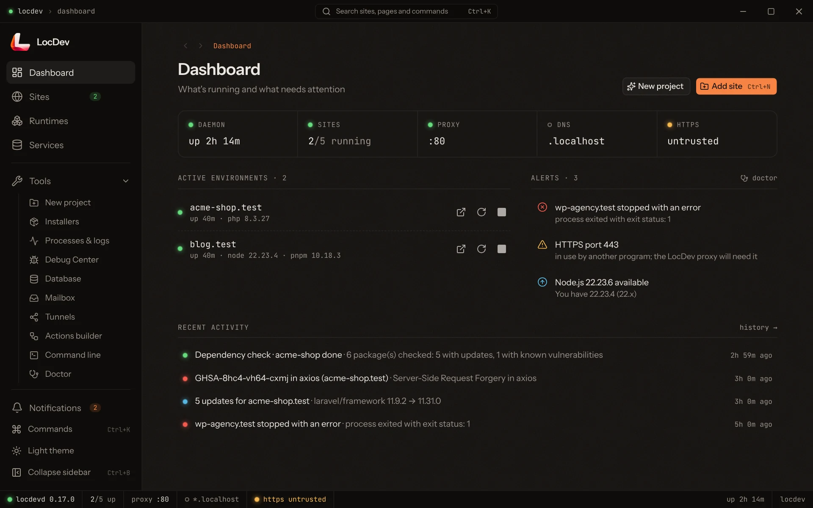

<p align="center"></p>

# LocDev

[English](README.md) · [Português (Brasil)](README.pt-BR.md) · [Español](README.es.md) · [日本語](README.ja.md)

Your projects, runtimes and development tools in one local workspace. LocDev is a free, open source development environment for **Linux, macOS and Windows**, with a desktop app, a CLI and a terminal UI backed by the same Rust daemon. Run PHP, Node.js and other stacks natively, without requiring Docker or WSL.

**[Documentation](https://locdev.app/en/docs) · [Download](https://locdev.app/en/download) · [Changelog](CHANGELOG.md) · [Support the project](https://locdev.app/en/donate)**



<a id="contents"></a>

## Contents

- [Install](#install)
- [Quick start](#quick-start)
- [What is included](#features)
- [Complete documentation](#documentation)
- [CLI reference](#cli)
- [Domains and HTTPS](#network)
- [Architecture and source development](#development)
- [Privacy, security and limitations](#security)
- [Contribute and support](#community)
- [Developer and license](#credits)

<a id="install"></a>

## Install

Download the installer for your operating system from the [download page](https://locdev.app/en/download) or [GitHub Releases](https://github.com/trbros/locdev/releases/latest). The desktop distribution includes `locdevd` and `locdev`. Available formats depend on the release: `.dmg`, `.msi`/NSIS `.exe`, `.AppImage`, `.deb` and `.rpm`. Check the assets actually published for your architecture.

For the standalone CLI, the installer verifies the archive against the release’s `SHA256SUMS`:

```sh
curl -fsSL https://github.com/trbros/locdev/releases/latest/download/install.sh | sh
```

```powershell
irm https://github.com/trbros/locdev/releases/latest/download/install.ps1 | iex
```

A published release is required for these URLs to work. OS code signing and the signed in-app updater are separate mechanisms; see the release notes for signing status. Existing runtimes can be used, and additional versions can be installed from LocDev.

<a id="quick-start"></a>

## Quick start

Register an existing project and start its development server. Replace the sample path with your project folder:

```sh
locdev start
locdev add /path/to/blog --name blog
locdev up blog
locdev domain blog
locdev logs blog -f
locdev doctor
```

Open the URL shown by `locdev domain blog`. Use the desktop app for the same operations, or run `locdev` without arguments for the terminal interface. The framework is detected and a development command is suggested; custom commands are supported. Stopping or unregistering a site does not delete its project files.

<a id="features"></a>

## What is included

| Area | Included |
| --- | --- |
| [Sites and frameworks](https://locdev.app/en/docs/sites) | Framework detection, project registration, monitored folders, site tabs, per-site domains, subdomains, custom commands, process logs and your preferred editor. Static HTML is served by LocDev itself. |
| [Runtimes and PHP](https://locdev.app/en/docs/runtimes) | Node.js and PHP per site; installed-version detection, defaults, project pins and terminal shims. npm, pnpm, Yarn, Bun and Composer integrations. PHP settings with diff, backup and validation; required and recommended extension diagnostics. |
| [New projects and installers](https://locdev.app/en/docs/new-project) | Official framework installers where available, with a command preview and interactive terminal. Laravel starter-kit options, runtime selection, optional database creation and site registration. Minimal initial files for stacks without a suitable generator. |
| [Services and databases](https://locdev.app/en/docs/services) | PostgreSQL, MariaDB/MySQL, MongoDB, Redis and Valkey instances with separate data, ports, logs and cold backups. Verified downloads where the publisher provides checksums; system package-manager integrations for other installations. |
| [Database Manager](https://locdev.app/en/docs/database) | SQL tables and rows, queries, editing and destructive-statement confirmation; Redis/Valkey key browsing. Credentials are resolved by the daemon. MongoDB instances are supported, but a MongoDB data browser is not included. |
| [Environment and secrets](https://locdev.app/en/docs/environment) | Shared variables and profiles, encrypted secrets and process-only injection that preserves project `.env` values. Reviewed synchronization, backups and history when writing environment files. |
| [Mailbox and Email Studio](https://locdev.app/en/docs/email-studio) | Local capture-only SMTP, per-site inboxes, attachments and framework wiring. Visual email blocks, Mailables and components, static or framework previews, with Blade outside managed blocks preserved. |
| [Configuration files](https://locdev.app/en/docs/config-files) | Forms for recognized options, source editing, analysis, diffs, backups and history. JSON and JS/TS are parsed without executing project configuration code; computed values may remain read-only. |
| [Git and GitHub](https://locdev.app/en/docs/git) | Changes, commits, branches, stashes, remotes and worktrees that can become sites. Destructive operations have previews, confirmation and backups. GitHub account integration, issues, pull requests and workflow runs. |
| [GitHub Actions](https://locdev.app/en/docs/actions) | Stack templates, visual and YAML editing, security validation, suggested fixes, optional actionlint installation and local workflow history. |
| [Dependencies](https://locdev.app/en/docs/dependencies) | Dependency listings, available updates, compatibility checks and OSV vulnerability checks, with update plans reviewed before execution. |
| [Deploy and sharing](https://locdev.app/en/docs/deploy) | Platform fit and readiness checks, configuration preparation and connected Vercel/Netlify API operations. Share a running site with a Cloudflare Quick Tunnel; understand its public-access and provider limits before use. |
| [Debug Center](https://locdev.app/en/docs/debug-center) | Process failures, exceptions, error logs, proxy 5xx responses and PHP dumps, grouped into problems with likely causes. Recognizable secrets are redacted before storage; retention is configurable. |
| [Metrics and Tinker](https://locdev.app/en/docs/metrics) | Proxy request counts, status classes, latency percentiles, busiest paths and recent requests, kept in memory. Laravel Tinker snippets and an interactive console use the site’s PHP and environment. |
| [Desktop experience](https://locdev.app/en/docs/app) | English, Brazilian Portuguese, Spanish and Japanese; light/dark themes, configurable shortcuts, command palette, tray, background jobs, notifications, updates and accessibility checks. |
| [Diagnostics and automation](https://locdev.app/en/docs/doctor) | Doctor checks runtimes, proxy, DNS, TLS and integration problems. Optional login startup, offline mode, job cancellation/retry and per-automation settings. |

<a id="documentation"></a>

## Complete documentation

The full manual is at **[locdev.app/docs](https://locdev.app/docs)**. Use the language-specific links below for installation, workflows, configuration, maintenance and reference material. The source articles are in [`apps/docs/content/docs`](apps/docs/content/docs).

- [What LocDev is](https://locdev.app/en/docs/introduction)
- [Installation](https://locdev.app/en/docs/installation)
- [Quick start](https://locdev.app/en/docs/getting-started)
- [App tour](https://locdev.app/en/docs/app)
- [Keyboard shortcuts](https://locdev.app/en/docs/shortcuts)
- [Tutorial: a Laravel site from scratch](https://locdev.app/en/docs/tutorial-laravel)
- [Tutorial: a Node.js project you already have](https://locdev.app/en/docs/tutorial-node)
- [Tutorial: PHP and Node.js versions per project and in the terminal](https://locdev.app/en/docs/tutorial-versions)
- [Sites and processes](https://locdev.app/en/docs/sites)
- [Parked folders](https://locdev.app/en/docs/parked-folders)
- [.test domains (DNS)](https://locdev.app/en/docs/domains)
- [Subdomains and wildcards](https://locdev.app/en/docs/subdomains)
- [HTTPS and the local CA](https://locdev.app/en/docs/https)
- [Runtimes and package managers](https://locdev.app/en/docs/runtimes)
- [PHP settings](https://locdev.app/en/docs/php-settings)
- [Frameworks and stacks](https://locdev.app/en/docs/frameworks)
- [Dev servers](https://locdev.app/en/docs/servers)
- [New project](https://locdev.app/en/docs/new-project)
- [Code editor](https://locdev.app/en/docs/editors)
- [Debug Center](https://locdev.app/en/docs/debug-center)
- [Request metrics](https://locdev.app/en/docs/metrics)
- [Tinker](https://locdev.app/en/docs/tinker)
- [Environment variables and secrets](https://locdev.app/en/docs/environment)
- [Services: databases and caches](https://locdev.app/en/docs/services)
- [Database Manager](https://locdev.app/en/docs/database)
- [Mailbox](https://locdev.app/en/docs/mailbox)
- [Email Studio](https://locdev.app/en/docs/email-studio)
- [Config Files](https://locdev.app/en/docs/config-files)
- [Deploy assistant](https://locdev.app/en/docs/deploy)
- [Tunnels](https://locdev.app/en/docs/tunnels)
- [Dependencies, jobs and notifications](https://locdev.app/en/docs/dependencies)
- [Git, GitHub and protection](https://locdev.app/en/docs/git)
- [GitHub Actions builder](https://locdev.app/en/docs/actions)
- [Troubleshooting](https://locdev.app/en/docs/doctor)
- [Troubleshooting](https://locdev.app/en/docs/troubleshooting)
- [Updating LocDev](https://locdev.app/en/docs/updating)
- [Uninstalling LocDev](https://locdev.app/en/docs/uninstalling)
- [CLI](https://locdev.app/en/docs/cli)
- [Configuration](https://locdev.app/en/docs/configuration)
- [Architecture](https://locdev.app/en/docs/architecture)
- [Security](https://locdev.app/en/docs/security)
- [Start at login](https://locdev.app/en/docs/service)

<a id="cli"></a>

## CLI reference

Use `locdev --help` and `locdev <command> --help` for exact arguments. The [complete CLI reference](https://locdev.app/en/docs/cli) is generated from the command definitions.

| Area | CLI |
| --- | --- |
| Daemon and diagnostics | `version`, `status`, `start`, `stop`, `restart`, `doctor` |
| Sites and discovery | `add`, `list`, `edit`, `up`, `down`, `reload`, `logs`, `remove`, `park`, `stack` |
| Network and certificates | `domain`, `subdomain`, `route`, `dns`, `tls`, `tunnel` |
| Runtimes | `runtime`, `tools` |
| Services and data | `service`, `db`, `env`, `mail` |
| Development tools | `new`, `config`, `email`, `debug`, `metrics`, `tinker`, `editor` |
| Code and automation | `git`, `github`, `actions`, `deps`, `deploy`, `jobs`, `notifications`, `settings`, `startup`, `update` |

<a id="network"></a>

## Domains and HTTPS

The proxy listens on loopback and routes site hostnames to development processes, including WebSocket upgrades. `.localhost` works without installing a DNS rule. To use `.test`, review and apply the DNS configuration. HTTPS uses a local CA whose trust is optional and explicit.

Linux uses systemd-resolved where available, macOS a per-domain resolver, and Windows NRPT. System changes show a plan before elevation. Other tools’ configuration is treated as a conflict, not silently replaced. Proxy defaults are HTTP 80 / HTTPS 443, with 7080 / 7443 fallbacks; Doctor explains conflicts.

```sh
locdev dns status
locdev dns install
locdev tls status
locdev tls trust
```

<a id="development"></a>

## Architecture and source development

The daemon owns business logic; CLI and desktop send requests over local IPC. Pure domain logic is split into Rust crates. The desktop uses Tauri, React and Tailwind; the documentation uses Next.js and next-intl.

For source development, install stable Rust (edition 2024), Node.js 22.18+ for the site’s TypeScript-based tests, and pnpm as pinned in each `package.json`. The desktop also needs the [Tauri system prerequisites](https://v2.tauri.app/start/prerequisites/).

```text
apps/locdev/       CLI + terminal UI
apps/desktop/      Tauri + React
apps/docs/         Next.js + next-intl
crates/            Rust: daemon, IPC, proxy, DNS, TLS, runtimes, tools
tools/definitions/ Framework definitions
```

```sh
git clone https://github.com/trbros/locdev.git
cd locdev
cargo build
cargo test
cd apps/desktop
pnpm install
pnpm tauri dev
```

`make check` runs the repository checks. See [`Makefile`](Makefile) for desktop, documentation, screenshots and accessibility targets. `pnpm dev` in `apps/desktop` uses a simulated daemon for UI work; `pnpm tauri dev` starts the native app. `LOCDEV_HOME` isolates development state, configuration and IPC; listening ports can still conflict with another daemon.

For website setup and deployment, read [`apps/docs/README.md`](apps/docs/README.md).

<a id="security"></a>

## Privacy, security and limitations

- Project files and application data are local by default. Registry queries, runtime downloads, GitHub, vulnerability checks, deploy providers and tunnels make network requests when used. A tunnel deliberately exposes a site outside your machine.

- The daemon runs as your user. DNS and CA trust changes request elevation separately. Secrets use the system keyring or an explicitly configured file-backed store; do not commit `.env` files or credentials.

- Database access is intended for development. Remote access requires explicit opt-in; database TLS support is limited. Review the [security guide](https://locdev.app/en/docs/security) before connecting sensitive data.

- Metrics include only traffic through LocDev’s proxy and disappear when the daemon restarts. Framework detection does not mean every version of every framework has been tested on every OS.

- Updater signature verification does not imply that every OS installer is code-signed. Check actual release assets, known issues and platform requirements before installation.

<a id="community"></a>

## Contribute and support

LocDev grows with its community. **If it saves you time, please help it keep growing:** star the repository, share it with other developers, report reproducible bugs, improve translations and documentation, test on your OS, or send a focused pull request.

- [Contribution guide](https://locdev.app/en/contribute)
- [Issues and feature requests](https://github.com/trbros/locdev/issues)
- [Community support and project support](https://locdev.app/en/donate)
- [Troubleshooting and support](https://locdev.app/en/support)

The support page describes the currently available ways to help; do not assume a payment channel exists. For vulnerabilities, use the [private security reporting channel](https://locdev.app/en/security) instead of a public issue.

<a id="credits"></a>

## Developer and license

<a href="https://triooo.com.br"><picture><source media="(prefers-color-scheme: dark)" srcset="apps/docs/public/brands/triooo/triooo_logo_dark.svg" /></picture></a>

Developed and maintained by **[triooo](https://triooo.com.br)**, together with community contributors.

LocDev is distributed under the **[Apache License 2.0](LICENSE)**. Third-party software retains its own licenses. See the app’s About section for dependency credits.
