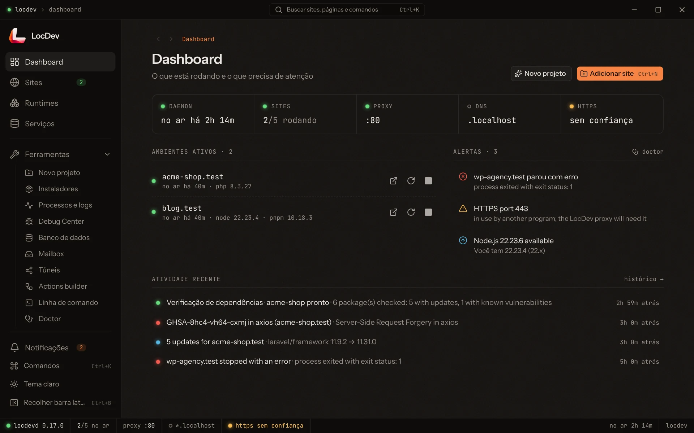

<p align="center"></p>

# LocDev

[English](README.md) · [Português (Brasil)](README.pt-BR.md) · [Español](README.es.md) · [日本語](README.ja.md)

Seus projetos, runtimes e ferramentas de desenvolvimento em um só lugar. O LocDev é um ambiente de desenvolvimento gratuito e de código aberto para **Linux, macOS e Windows**, com app desktop, CLI e interface de terminal sobre o mesmo daemon em Rust. Execute PHP, Node.js e outras stacks nativamente, sem exigir Docker ou WSL.

**[Documentação](https://locdev.app/pt-BR/docs) · [Download](https://locdev.app/pt-BR/download) · [Histórico de alterações](CHANGELOG.pt-BR.md) · [Apoie o projeto](https://locdev.app/pt-BR/donate)**



<a id="contents"></a>

## Índice

- [Instalação](#install)
- [Primeiros passos](#quick-start)
- [O que está incluído](#features)
- [Documentação completa](#documentation)
- [Referência da CLI](#cli)
- [Domínios e HTTPS](#network)
- [Arquitetura e desenvolvimento](#development)
- [Privacidade, segurança e limitações](#security)
- [Contribua e apoie](#community)
- [Desenvolvedora e licença](#credits)

<a id="install"></a>

## Instalação

Baixe o instalador do seu sistema na [página de downloads](https://locdev.app/pt-BR/download) ou nas [releases do GitHub](https://github.com/trbros/locdev/releases/latest). A distribuição desktop inclui `locdevd` e `locdev`. Os formatos dependem da release: `.dmg`, `.msi`/NSIS `.exe`, `.AppImage`, `.deb` e `.rpm`. Confira os arquivos realmente publicados para sua arquitetura.

Para usar somente a CLI, o instalador verifica o arquivo pelo `SHA256SUMS` da release:

```sh
curl -fsSL https://github.com/trbros/locdev/releases/latest/download/install.sh | sh
```

```powershell
irm https://github.com/trbros/locdev/releases/latest/download/install.ps1 | iex
```

Esses endereços exigem uma release publicada. A assinatura de código do sistema operacional e o atualizador assinado do app são mecanismos diferentes; consulte as notas da release para saber o estado das assinaturas. Você pode usar runtimes já instalados ou instalar versões pelo LocDev.

<a id="quick-start"></a>

## Primeiros passos

Cadastre um projeto existente e inicie seu servidor de desenvolvimento. Troque o caminho do exemplo pela pasta do seu projeto:

```sh
locdev start
locdev add /path/to/blog --name blog
locdev up blog
locdev domain blog
locdev logs blog -f
locdev doctor
```

Abra a URL exibida por `locdev domain blog`. O app desktop oferece as mesmas operações; execute `locdev` sem argumentos para abrir a interface de terminal. O framework é detectado e um comando de desenvolvimento é sugerido; comandos personalizados também são aceitos. Parar ou remover um site do cadastro não apaga os arquivos do projeto.

<a id="features"></a>

## O que está incluído

| Área | Recursos |
| --- | --- |
| [Sites e frameworks](https://locdev.app/pt-BR/docs/sites) | Detecção de frameworks, cadastro de projetos, diretórios monitorados, abas de sites, domínios, subdomínios, comandos personalizados, logs e editor de código preferido. O próprio LocDev serve sites HTML estáticos. |
| [Runtimes e PHP](https://locdev.app/pt-BR/docs/runtimes) | Node.js e PHP por site, detecção de versões instaladas, padrões, versões fixadas por projeto e scripts para o terminal. Integrações com npm, pnpm, Yarn, Bun e Composer. Configurações do PHP com diff, backup e validação; diagnóstico de extensões obrigatórias e recomendadas. |
| [Novos projetos e instaladores](https://locdev.app/pt-BR/docs/new-project) | Instaladores oficiais dos frameworks quando disponíveis, com prévia do comando e terminal interativo. Opções de starter kit do Laravel, escolha de runtime, banco opcional e cadastro do site. Arquivos iniciais mínimos para stacks sem gerador adequado. |
| [Serviços e bancos](https://locdev.app/pt-BR/docs/services) | Instâncias de PostgreSQL, MariaDB/MySQL, MongoDB, Redis e Valkey com dados, portas, logs e backups a frio separados. Downloads verificados quando a fonte publica checksums; integração com gerenciadores de pacotes do sistema para outras instalações. |
| [Database Manager](https://locdev.app/pt-BR/docs/database) | Tabelas, linhas, consultas e edição SQL, com confirmação de comandos destrutivos; navegador de chaves Redis/Valkey. Credenciais resolvidas pelo daemon. Há suporte a instâncias MongoDB, mas não a um navegador de dados MongoDB. |
| [Ambiente e secrets](https://locdev.app/pt-BR/docs/environment) | Variáveis e perfis compartilhados, secrets cifrados e injeção somente no processo, preservando valores do `.env` do projeto. Sincronização revisada, backups e histórico ao gravar arquivos de ambiente. |
| [Mailbox e Email Studio](https://locdev.app/pt-BR/docs/email-studio) | SMTP local apenas de captura, caixas por site, anexos e integração por framework. Blocos visuais de e-mail, Mailables, componentes e prévias estáticas ou pelo framework, preservando o Blade fora dos blocos gerenciados. |
| [Arquivos de configuração](https://locdev.app/pt-BR/docs/config-files) | Formulários para opções reconhecidas, edição de código, análise, diffs, backups e histórico. JSON e JS/TS são analisados sem executar a configuração do projeto; valores calculados podem ficar somente para leitura. |
| [Git e GitHub](https://locdev.app/pt-BR/docs/git) | Alterações, commits, branches, stashes, remotos e worktrees que podem virar sites. Operações destrutivas têm prévia, confirmação e backups. Integração de conta do GitHub, issues, pull requests e execuções de workflows. |
| [GitHub Actions](https://locdev.app/pt-BR/docs/actions) | Templates por stack, edição visual e YAML, validação de segurança, sugestões de correção, instalação opcional do actionlint e histórico local de workflows. |
| [Dependências](https://locdev.app/pt-BR/docs/dependencies) | Listagem de dependências, atualizações disponíveis, compatibilidade e vulnerabilidades pelo OSV, com planos de atualização revisados antes da execução. |
| [Deploy e compartilhamento](https://locdev.app/pt-BR/docs/deploy) | Compatibilidade com plataformas, checagem de preparo, geração de configurações e operações nas APIs da Vercel/Netlify conectadas. Compartilhe um site em execução com Cloudflare Quick Tunnel, considerando o acesso público e os limites do provedor. |
| [Debug Center](https://locdev.app/pt-BR/docs/debug-center) | Falhas de processos, exceções, logs de erro, respostas 5xx do proxy e dumps PHP, agrupados por problema com causas prováveis. Secrets reconhecíveis são ocultados antes do armazenamento; a retenção é configurável. |
| [Métricas e Tinker](https://locdev.app/pt-BR/docs/metrics) | Contagem de requisições do proxy, classes de status, percentis de latência, caminhos mais acessados e requisições recentes, somente em memória. Snippets e console interativo do Laravel Tinker com PHP e ambiente do site. |
| [Experiência desktop](https://locdev.app/pt-BR/docs/app) | Português brasileiro, inglês, espanhol e japonês; temas claro/escuro, atalhos configuráveis, paleta de comandos, bandeja, tarefas em segundo plano, notificações, atualizações e verificações de acessibilidade. |
| [Diagnóstico e automação](https://locdev.app/pt-BR/docs/doctor) | O Doctor verifica runtimes, proxy, DNS, TLS e integrações. Inicialização opcional no login, modo offline, cancelamento e repetição de tarefas e configurações por automação. |

<a id="documentation"></a>

## Documentação completa

O manual completo está em **[locdev.app/docs](https://locdev.app/docs)**. Os links abaixo abrem a documentação em português para instalação, fluxos de trabalho, configuração, manutenção e referências. Os artigos-fonte ficam em [`apps/docs/content/docs`](apps/docs/content/docs).

- [O que é o LocDev](https://locdev.app/pt-BR/docs/introduction)
- [Instalação](https://locdev.app/pt-BR/docs/installation)
- [Início rápido](https://locdev.app/pt-BR/docs/getting-started)
- [Tour pelo app](https://locdev.app/pt-BR/docs/app)
- [Atalhos de teclado](https://locdev.app/pt-BR/docs/shortcuts)
- [Tutorial: um site Laravel do zero](https://locdev.app/pt-BR/docs/tutorial-laravel)
- [Tutorial: um projeto Node.js que você já tem](https://locdev.app/pt-BR/docs/tutorial-node)
- [Tutorial: versões de PHP e Node.js por projeto e no terminal](https://locdev.app/pt-BR/docs/tutorial-versions)
- [Sites e processos](https://locdev.app/pt-BR/docs/sites)
- [Diretórios monitorados](https://locdev.app/pt-BR/docs/parked-folders)
- [Domínios .test (DNS)](https://locdev.app/pt-BR/docs/domains)
- [Subdomínios e wildcards](https://locdev.app/pt-BR/docs/subdomains)
- [HTTPS e CA local](https://locdev.app/pt-BR/docs/https)
- [Runtimes e gerenciadores de pacotes](https://locdev.app/pt-BR/docs/runtimes)
- [Configurações do PHP](https://locdev.app/pt-BR/docs/php-settings)
- [Frameworks e stacks](https://locdev.app/pt-BR/docs/frameworks)
- [Servidores de desenvolvimento](https://locdev.app/pt-BR/docs/servers)
- [Novo projeto](https://locdev.app/pt-BR/docs/new-project)
- [Editor de código](https://locdev.app/pt-BR/docs/editors)
- [Debug Center](https://locdev.app/pt-BR/docs/debug-center)
- [Métricas de requisições](https://locdev.app/pt-BR/docs/metrics)
- [Tinker](https://locdev.app/pt-BR/docs/tinker)
- [Variáveis de ambiente e secrets](https://locdev.app/pt-BR/docs/environment)
- [Serviços: bancos e caches](https://locdev.app/pt-BR/docs/services)
- [Database Manager](https://locdev.app/pt-BR/docs/database)
- [Mailbox](https://locdev.app/pt-BR/docs/mailbox)
- [Email Studio](https://locdev.app/pt-BR/docs/email-studio)
- [Config Files](https://locdev.app/pt-BR/docs/config-files)
- [Assistente de deploy](https://locdev.app/pt-BR/docs/deploy)
- [Túneis](https://locdev.app/pt-BR/docs/tunnels)
- [Dependências, jobs e notificações](https://locdev.app/pt-BR/docs/dependencies)
- [Git, GitHub e proteção](https://locdev.app/pt-BR/docs/git)
- [GitHub Actions Builder](https://locdev.app/pt-BR/docs/actions)
- [Solução de problemas](https://locdev.app/pt-BR/docs/doctor)
- [Solução de problemas](https://locdev.app/pt-BR/docs/troubleshooting)
- [Atualizar o LocDev](https://locdev.app/pt-BR/docs/updating)
- [Desinstalar o LocDev](https://locdev.app/pt-BR/docs/uninstalling)
- [CLI](https://locdev.app/pt-BR/docs/cli)
- [Configuração](https://locdev.app/pt-BR/docs/configuration)
- [Arquitetura](https://locdev.app/pt-BR/docs/architecture)
- [Segurança](https://locdev.app/pt-BR/docs/security)
- [Iniciar com o sistema](https://locdev.app/pt-BR/docs/service)

<a id="cli"></a>

## Referência da CLI

Use `locdev --help` e `locdev <comando> --help` para consultar os argumentos exatos. A [referência completa da CLI](https://locdev.app/pt-BR/docs/cli) é gerada a partir das definições dos comandos.

| Área | CLI |
| --- | --- |
| Daemon e diagnóstico | `version`, `status`, `start`, `stop`, `restart`, `doctor` |
| Sites e descoberta | `add`, `list`, `edit`, `up`, `down`, `reload`, `logs`, `remove`, `park`, `stack` |
| Rede e certificados | `domain`, `subdomain`, `route`, `dns`, `tls`, `tunnel` |
| Runtimes | `runtime`, `tools` |
| Serviços e dados | `service`, `db`, `env`, `mail` |
| Ferramentas de desenvolvimento | `new`, `config`, `email`, `debug`, `metrics`, `tinker`, `editor` |
| Código e automação | `git`, `github`, `actions`, `deps`, `deploy`, `jobs`, `notifications`, `settings`, `startup`, `update` |

<a id="network"></a>

## Domínios e HTTPS

O proxy escuta em loopback e encaminha os nomes dos sites para os processos de desenvolvimento, incluindo WebSockets. `.localhost` funciona sem instalar regra DNS. Para usar `.test`, revise e aplique a configuração DNS. O HTTPS usa uma CA local cuja confiança é opcional e explícita.

O Linux usa systemd-resolved quando disponível, o macOS um resolvedor por domínio e o Windows NRPT. Alterações do sistema mostram um plano antes da elevação. Configurações de outras ferramentas são tratadas como conflito, sem substituição silenciosa. O proxy usa HTTP 80 / HTTPS 443, com fallback para 7080 / 7443; o Doctor explica conflitos.

```sh
locdev dns status
locdev dns install
locdev tls status
locdev tls trust
```

<a id="development"></a>

## Arquitetura e desenvolvimento

O daemon concentra a lógica de negócio; CLI e desktop enviam pedidos por IPC local. A lógica de domínio fica em crates Rust. O desktop usa Tauri, React e Tailwind; a documentação usa Next.js e next-intl.

Para desenvolver a partir do código, instale Rust estável (edition 2024), Node.js 22.18+ para os testes TypeScript do site e o pnpm indicado em cada `package.json`. O desktop também exige os [pré-requisitos de sistema do Tauri](https://v2.tauri.app/start/prerequisites/).

```text
apps/locdev/       CLI + terminal UI
apps/desktop/      Tauri + React
apps/docs/         Next.js + next-intl
crates/            Rust: daemon, IPC, proxy, DNS, TLS, runtimes, tools
tools/definitions/ Framework definitions
```

```sh
git clone https://github.com/trbros/locdev.git
cd locdev
cargo build
cargo test
cd apps/desktop
pnpm install
pnpm tauri dev
```

`make check` executa as verificações do repositório. Consulte o [`Makefile`](Makefile) para os alvos do desktop, documentação, capturas e acessibilidade. `pnpm dev` em `apps/desktop` usa um daemon simulado para trabalhar na interface; `pnpm tauri dev` abre o app nativo. `LOCDEV_HOME` isola estado, configuração e IPC; portas ainda podem conflitar com outro daemon.

Para configurar e publicar o site, leia [`apps/docs/README.pt-BR.md`](apps/docs/README.pt-BR.md).

<a id="security"></a>

## Privacidade, segurança e limitações

- Arquivos de projetos e dados do app ficam locais por padrão. Consultas a registros, downloads de runtimes, GitHub, verificação de vulnerabilidades, provedores de deploy e túneis fazem conexões quando usados. Um túnel expõe deliberadamente um site fora da máquina.

- O daemon roda como seu usuário. DNS e confiança da CA pedem elevação separadamente. Secrets usam o keyring do sistema ou um armazenamento em arquivo configurado explicitamente; não versione `.env` ou credenciais.

- O acesso a bancos é voltado ao desenvolvimento. Conexões remotas exigem escolha explícita; o suporte a TLS dos bancos é limitado. Leia o [guia de segurança](https://locdev.app/pt-BR/docs/security) antes de conectar dados sensíveis.

- Métricas contam apenas o tráfego que passa pelo proxy e são perdidas ao reiniciar o daemon. Detectar um framework não significa que todas as versões foram testadas em todos os sistemas.

- A verificação da assinatura do atualizador não implica que todo instalador tenha assinatura de código do sistema. Confira os arquivos da release, problemas conhecidos e requisitos da plataforma.

<a id="community"></a>

## Contribua e apoie

O LocDev cresce com a comunidade. **Se ele economiza seu tempo, ajude o projeto a continuar:** dê uma estrela no repositório, compartilhe com outros desenvolvedores, relate bugs reproduzíveis, melhore traduções e documentação, teste no seu sistema ou envie uma pull request focada.

[](https://github.com/sponsors/bnacci)
[](https://buymeacoffee.com/bnacci)

- [Como contribuir](https://locdev.app/pt-BR/contribute)
- [Bugs e pedidos de recursos](https://github.com/trbros/locdev/issues)
- [Apoio da comunidade e ao projeto](https://locdev.app/pt-BR/donate)
- [Resolução de problemas e suporte](https://locdev.app/pt-BR/support)

Para apoiar o trabalho financeiramente, patrocine bnacci pelo [GitHub Sponsors](https://github.com/sponsors/bnacci) ou pelo [Buy Me a Coffee](https://buymeacoffee.com/bnacci). Para vulnerabilidades, use o [canal privado de segurança](https://locdev.app/pt-BR/security), em vez de abrir uma issue pública.

<a id="credits"></a>

## Desenvolvedora e licença

<a href="https://triooo.com.br"><picture><source media="(prefers-color-scheme: dark)" srcset="apps/docs/public/brands/triooo/triooo_logo_dark.svg" /></picture></a>

Desenvolvido e mantido pela **[triooo](https://triooo.com.br)**, junto com os contribuidores da comunidade.

O LocDev é distribuído sob a **[licença Apache 2.0](LICENSE)**. Dependências mantêm suas próprias licenças. Os créditos de terceiros ficam na seção Sobre do app.
